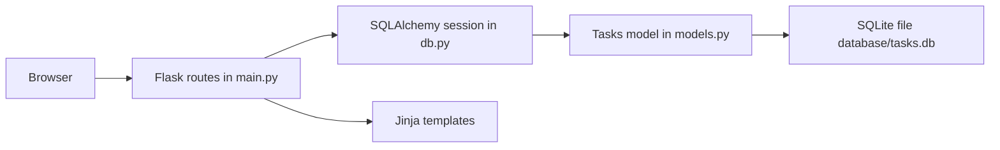

<div align="center">

# Flask SQL Task Manager

**A small task manager web app built with Flask and SQLAlchemy: create, complete, edit, delete and filter tasks stored in SQLite.**

[](LICENSE)


</div>

Flask SQL Task Manager ("App Gestor de Tareas") is a practice project for learning how to connect a Flask web application to a relational database through the SQLAlchemy ORM. Tasks have a description, a category and a due date, and are persisted in a local SQLite file. The user interface is a single Bootstrap page in Spanish.

It is a learning project: the code is small, heavily commented and intended to show the full create-read-update-delete cycle end to end. Known rough edges are listed in [Status](#status).

## Table of Contents

- [Overview](#overview)
- [Key Features](#key-features)
- [How It Works](#how-it-works)
- [Data Model](#data-model)
- [Tech Stack](#tech-stack)
- [Project Structure](#project-structure)
- [Getting Started](#getting-started)
- [Usage](#usage)
- [Testing](#testing)
- [Status](#status)
- [License](#license)
- [Author](#author)

## Overview

The application serves one main page with a form to add a task and a table listing the tasks. Each row has icons to mark the task as done (or undo it), delete it and edit it. The routes read and write through a SQLAlchemy session bound to a SQLite database in the `database` folder.

## Key Features

- **Create tasks** with a description, a category (Familia, Trabajo, Ocio, Académico) and a due date.
- **Toggle completion**: a done task is shown with strike-through text; clicking again reverts it.
- **Edit tasks** on a dedicated page (description, category and due date).
- **Delete tasks** with a single click.
- **Filter by category** through the `/tasks_by_category/<category>` route.
- **Automatic table creation**: the `tasks` table is created at start-up if it does not exist.
- **Responsive layout** using Bootstrap 4 from a CDN.

## How It Works



1. `db.py` creates the SQLAlchemy engine for `sqlite:///database/tasks.db` (with `check_same_thread` disabled so Flask can use it from several threads), a session and the declarative `Base`.
2. `models.py` maps the `Tasks` class to the `tasks` table.
3. `main.py` defines the Flask application and its routes. Each route queries or modifies tasks through the session and then renders a template or redirects to the home page.
4. When the script is run directly, `Base.metadata.create_all` creates the tables and the development server starts in debug mode.

## Data Model

Table `tasks` (class `Tasks`):

| Column | Type | Constraints |
|--------|------|-------------|
| `id_task` | Integer | Primary key, auto-increment |
| `content` | String(200) | Not null |
| `done` | Boolean | Set to false on creation |
| `category` | String(50) | Not null |
| `due_date` | Date | Not null |

## Tech Stack

| Area | Technology |
|------|------------|
| Language | Python 3 |
| Web framework | Flask (`Flask~=2.2.3`) |
| ORM | SQLAlchemy (`SQLAlchemy~=2.0.6`) |
| Database | SQLite |
| Front end | Jinja2 templates, Bootstrap 4.5 and Font Awesome from CDNs, custom CSS |

## Project Structure

```text
flask_sql_web/
├── LICENSE
├── README.md
├── requirements.txt         # Flask and SQLAlchemy
├── main.py                  # Flask app and routes
├── db.py                    # Engine, session and declarative base
├── models.py                # Tasks model
├── database/
│   └── tasks.db             # SQLite database file
├── static/
│   ├── main.css             # Styles used by the pages
│   └── index.html           # Earlier page design, not used by the app
└── templates/
    ├── index.html           # Main page: form and task table
    ├── edit.html            # Edit page
    └── main.css             # Copy of an earlier stylesheet, not used by the app
```

## Getting Started

### Prerequisites

- Python 3 and `pip`

### Installation

```bash
git clone https://github.com/LargoLujan/flask_sql_web
cd flask_sql_web
python -m venv .venv
```

Activate the virtual environment:

```bash
# Windows (PowerShell)
.\.venv\Scripts\Activate.ps1

# macOS / Linux
source .venv/bin/activate
```

Install the dependencies:

```bash
pip install -r requirements.txt
```

### Configuration

There is no configuration file and no environment variables. The database location is set in `db.py` as the relative path `database/tasks.db`, so run the app from the repository root. Debug mode is switched on in `main.py` (`app.run(debug=True)`); disable it if you expose the app beyond your own machine.

### Running

```bash
python main.py
```

Then open `http://127.0.0.1:5000/`. The port can be changed in the `app.run` call.

## Usage

### Routes

| Method | URL | Description |
|--------|-----|-------------|
| GET | `/` | Main page: add form and list of all tasks |
| POST | `/create_task` | Create a task from the form fields `content_task`, `category` and `due_date` (`YYYY-MM-DD`) |
| GET | `/done-task/<id>` | Toggle the done flag of a task |
| GET | `/delete-task/<id>` | Delete a task |
| GET | `/tasks_by_category/<category>` | Main page filtered by category (`familia`, `trabajo`, `ocio`, `academico`) |
| GET | `/edit-task/<id>` | Edit form for a task |
| POST | `/update_task/<id>` | Save the edited description, category and due date |

### Typical flow

1. Type a task, choose a category and a due date, and press "Guardar".
2. Use the green check icon to mark it done, the blue pencil to edit it and the red bin to delete it.
3. To see one category only, open `/tasks_by_category/trabajo` (or another category) in the browser; the page has no link for this yet.

## Testing

There are no automated tests.

## Status

| Area | State |
|------|-------|
| Create, list, complete, delete, filter | Working as written |
| Edit | Saves description, category and due date through `/update_task/<id>`. The edit page does not pre-fill the description (the template reads `content_task` while the model attribute is `content`), and the "Completada" checkbox on the edit page is not saved |
| `/edit-task/<id>` POST handler | Not reached by the form, and it calls `datetime.strptime` on the imported module, so it would fail if used |
| Safety of state-changing routes | Delete and toggle use GET links without confirmation or CSRF protection, acceptable for a local practice app only |
| Packaging | The repository includes a committed virtual environment and a copy of the SQLite database |

## License

Distributed under the MIT License. See [LICENSE](LICENSE) for details.

## Author

**Manuel Luján Vílchez** — Senior Data Engineer

[](https://github.com/LargoLujan)
[](https://www.linkedin.com/in/manuel-lujan-vilchez)
